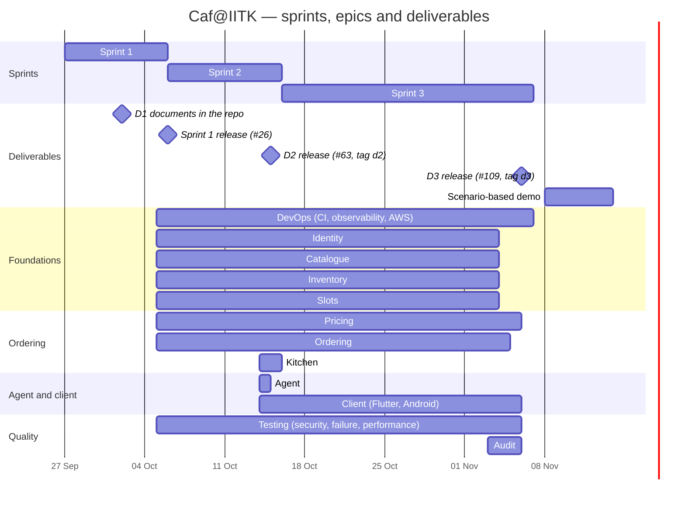

# Project Timeline and Gantt Chart

Caf@IITK, Team XForce. Every date below comes from Jira (sprint start, end and completion dates; issue resolution dates) or from GitHub (PR merge dates). All dates are IST. GitHub renders the chart below.

## 1. Plan against actual

The D1 project management report planned four phases. The team ran them as three sprints, folding the last two phases into Sprint 3:

| D1 roadmap phase | Planned | Ran as | Actual (Jira) |
|---|---|---|---|
| Phase 1 | 27 Sep – 5 Oct | Sprint 1 | 27 Sep – 5 Oct (completed 5 Oct) |
| Phase 2 | 6 – 15 Oct | Sprint 2 | 6 – 15 Oct (completed 15 Oct) |
| Phase 3 | 16 – 26 Oct | Sprint 3 | 16 Oct – 6 Nov (completed 6 Nov) |
| Phase 4 | 27 Oct – 6 Nov | Sprint 3 | (as above) |

## 2. Gantt chart

Each epic's bar runs from its first to its last merged feature PR; documentation and release PRs are left out. The bars are short because the team merged most work close to the end of each sprint.

## 3. Sprint summary

| Sprint | Dates | Goal (summarised from Jira) | Issues in sprint | Release |
|---|---|---|---|---|
| 1 | 27 Sep – 5 Oct | A student can place an order that atomically reserves inventory and a slot, proven correct under concurrent load, on top of working Identity, Catalogue, Inventory and Slot foundations, with CI green on every merged PR | 18 (14 stories, 4 tasks) | #26, 6 Oct |
| 2 | 6 – 15 Oct | Modify, cancel and track orders; the kitchen preparation queue; agent proposals that take effect only on an Administrator's approval, all through the Flutter client | 24 (15 stories, 9 tasks) | #63, tag `d2`, 15 Oct |
| 3 | 16 Oct – 6 Nov | Finish the remaining features, harden the system, deploy to AWS, measure and tune performance, and run the failure, security and client test campaigns, logging every defect as a Bug | 38 (16 stories, 15 tasks, 7 bugs) | #109, tag `d3`, 6 Nov |

CAFIITK-138 and CAFIITK-155 carried over from Sprint 1 into Sprint 2, so they are counted in both.

## 4. When work was closed

Issues resolved per day (all 187 non-epic issues):

| Date | Resolved |
|---|---|
| 5 Oct | 41 |
| 6 Oct | 5 |
| 14 Oct | 15 |
| 15 Oct | 46 |
| 3 Nov | 35 |
| 4 Nov | 21 |
| 5 Nov | 16 |
| 6 Nov | 8 |

No issue was resolved on any other day.

The project's weak point is that closures came in bursts at sprint ends rather than steadily. See `Project-Report.md` §5.
